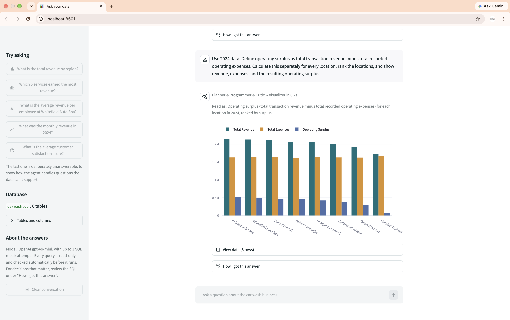
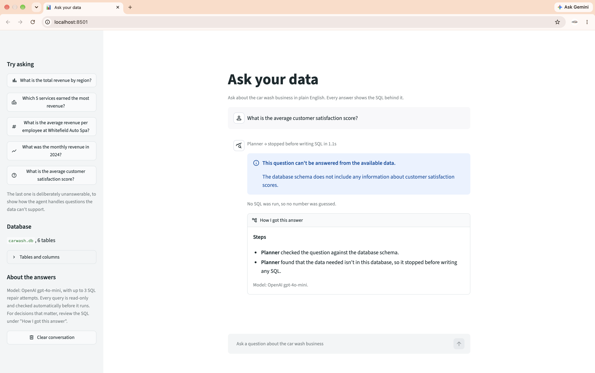
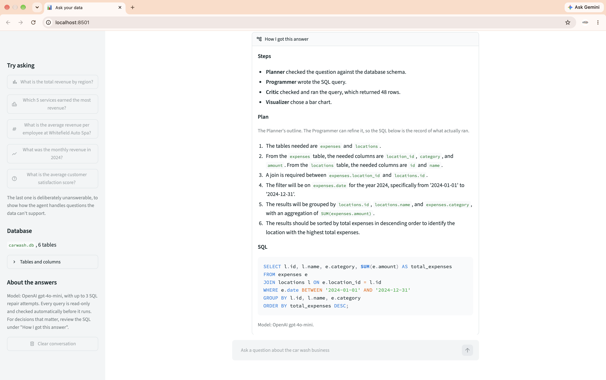

# Ask your data

Ask a business question in plain English and get the answer as a chart, a single number or a table, with the SQL behind it. Four agents plan the query, write it, check it and choose how to show the result. When the data can't answer a question, the app says so instead of guessing.

The demo runs on a synthetic database for a car wash and detailing chain with eight locations across India.

**[Try the live demo](https://multi-agent-text-to-sql.streamlit.app)**. If it shows a wake-up button, click it and wait about a minute.

https://github.com/user-attachments/assets/240e8a60-3fc0-4e0c-925d-26e8969efb4d



## What makes it different

Most text-to-SQL demos stop when the query runs. This one keeps checking after that, because a query can run cleanly and still return the wrong number.

- **It refuses rather than guesses.** Ask for the average customer satisfaction score and the Planner sees there is no such data. It stops before any SQL is written, so no number is shown.
- **It catches joins that inflate totals.** Before running a query, the Critic reads every join condition against the primary keys. If a SUM, AVG or COUNT would add up repeated rows, the query goes back to the Programmer with the reason.
- **It catches totals at the wrong level.** If a result meant to list one row per region and category repeats a region and category, the Critic sends it back.
- **It says how it read the question.** Every answer starts with a "Read as" line, such as "Profit (total revenue minus total expenses) for each location, all dates". A vague word like "profitable" can't be quietly swapped for revenue.
- **It says what it left out.** A question that asks for two different results ("show expenses by location and category. Also identify which location had the highest total.") is split before any model sees it. The first part is answered, and the second is offered as a one-click follow-up, so it can't distort the first.
- **It shows its working.** "How I got this answer" lists each agent's step, the plan and the exact SQL that ran.



## How it works

```
question
   │ a second part that needs its own result is held back as a follow-up
   ▼
Planner ──── data not in the schema ───► "can't be answered" (no SQL is written)
   │ plan + "Read as" line
   ▼
Programmer ◄──── rejected, with the reason (up to 3 repairs) ────┐
   │ one read-only SQL query                                     │
   ▼                                                             │
Critic: is it a single SELECT? do the joins inflate any total? ──┤
        run it read-only; does any group repeat? ────────────────┘
   │ checked result
   ▼
Visualizer: bar chart, line chart, single number or table
```

| Agent | File | What it does |
|---|---|---|
| Planner | `src/agents/planner.py` | Reads the question and the schema (with three sample rows per table) and writes a plan: tables, joins, filters, grouping. It adds a "Read as" line, marks a question as unanswerable when the data isn't there, and names any part of the question the plan can't cover. When the question was split, it plans the first part only and rewords the second so it can be asked on its own. |
| Programmer | `src/agents/programmer.py` | Writes one SQLite query from the plan. On a retry it gets the rejected SQL and the Critic's reason. It is shown only the part of the question being answered. The code keeps only the first statement and replaces "today" with the latest date in the data. |
| Critic | `src/agents/critic.py` | Rejects anything but a single read-only SELECT, checks every join for fan-out, runs the query on a read-only connection, and checks the result for repeated groups. |
| Visualizer | `src/agents/visualizer.py` | Picks the chart from the shape of the result, without an LLM: a time column gives a line chart, labels with a measure give a bar chart, one row gives a single number. Two label columns or several measures become separate coloured series. |

LangGraph (`src/graph.py`) wires the agents together, including the retry loop. The Streamlit app (`app.py`) streams each step as it happens.

### Two-part questions

Each answer is one query that returns one table. "Show 2024 expenses by location and category. Also identify which location had the highest total." asks for two tables of different shapes. Given both parts, the model sometimes folded the second into the first by adding `LIMIT 1` to the breakdown, which returned a single row that answered neither part.

`src/question_parts.py` now makes the split in code. A later sentence is held back when it starts with "Also", "Additionally", "In addition", "Furthermore" or "Plus" and asks something of its own (a question word such as "which" or "how many", or a superlative such as "highest"). The Planner and the Programmer see the first part only. The second part is reworded to stand on its own ("Which location had the highest total expenses in 2024?") and shown under the answer with an "Ask this next" button. Sentences that only adjust the first result, such as "Also include the city" or "Also sort them by revenue", are not split.

### The fan-out check

Joining `transactions` to `locations` is safe: each transaction has one location. Joining a location to both its transactions and its expenses is not: every transaction is repeated once per expense row, so the revenue total is multiplied. The query still runs and returns a plausible number.

The Critic reads each `ON` condition. `t.location_id = l.id` matches the primary key of `locations`, so each transaction meets at most one location. A query passes when some table can reach every other table through steps like that, and each SUM, AVG or COUNT adds up that table's columns. Subqueries and CTEs are checked on their own, with their GROUP BY telling which columns are unique. `test_heuristics.py` has 30 fan-out cases: the two real bugs found while building this, nine more wrong patterns, and nineteen correct queries that must pass.

## The demo data

`data/carwash.db` is a SQLite database built by `data/seed_database.py`:

| Table | Rows | What it holds |
|---|---|---|
| `locations` | 8 | Two in Bengaluru, one each in Chennai, Hyderabad, Mumbai, Pune, Delhi and Kolkata, across four regions |
| `services` | 12 | Washes, detailing, maintenance and add-ons, with base prices |
| `employees` | 49 | Five to eight per location |
| `transactions` | 20,000 | Sales from 19 September 2023 to 18 September 2026 |
| `expenses` | 1,824 | Monthly rent, salaries, utilities, supplies, marketing and maintenance per location |
| `inventory` | 80 | Stock levels per location and product |

The seed is fixed and the data always ends on 18 September 2026, so rebuilding the database gives the same transactions and expenses every time. A relative period such as "the last 12 months" is counted back from that date, not from the real current date.

## Run it locally

You need Python 3.13 and an OpenAI API key.

```bash
git clone https://github.com/praharsh-singh/multi-agent-text-to-sql.git
cd multi-agent-text-to-sql
python3 -m venv .venv
source .venv/bin/activate
pip install -r requirements.txt
export OPENAI_API_KEY="sk-..."
streamlit run app.py
```

The app opens at http://localhost:8501. The database is included, so there's nothing to set up. To rebuild it from scratch, run `python data/seed_database.py`.

Settings are in `src/config.py`: the model (`gpt-4o-mini` at temperature 0), the number of repair attempts (3), the rows shown to the Planner per table (3) and the most rows a result returns (1,000).

The code can also use a local model through Ollama: install `langchain-ollama`, start Ollama, and set `LLM_PROVIDER = "ollama"` in `src/config.py`. This path hasn't been tested end to end.

## Tests

```bash
python test_visualizer.py      # chart type for 10 result shapes
python test_charts.py          # 12 checks of what each chart draws
python test_heuristics.py      # 43 checks of the Critic
python test_question_parts.py  # 23 checks of two-part questions
python test_regression.py      # 13 checks against the database
python show_retries.py         # every SQL attempt and the Critic's verdict
```

The first four need no API key. `test_regression.py` and `show_retries.py` call OpenAI.

`test_regression.py` doesn't hard-code expected answers. For each question it runs a hand-written query against the database and checks that the pipeline's result contains the same numbers, one row each. It covers totals by region, the top five services, revenue per employee, monthly revenue, profit, operating surplus, two two-part questions, a three-table breakdown and a relative period. It also asks the per-employee question three more times to check the answer stays the same, and prints the Critic's reason whenever a query was sent back.

Some figures it confirms:

| Question | Answer |
|---|---|
| Total revenue by region | South 24,556,363.05 · West 11,831,691.57 · North 6,413,153.94 · East 6,245,128.67 |
| Average revenue per employee at Whitefield Auto Spa | 1,270,226.53 (6,351,132.66 across 5 employees) |
| Most profitable location, all dates | Whitefield Auto Spa, 1,190,217.27 |
| Highest operating surplus in 2024 | Kolkata Salt Lake, 510,275.18 |
| Average customer satisfaction score | Refused: the data has no satisfaction scores |



## Project structure

```
app.py                       Streamlit interface
src/
  config.py                  Settings
  llm.py                     Chooses OpenAI or Ollama
  graph.py                   LangGraph wiring and routing
  schema_inspector.py        Schema description given to the Planner
  data_coverage.py           Date range of the data, and what counts as "today"
  question_parts.py          Splits a two-part question into a main part and a follow-up
  logger.py                  Logging
  agents/
    state.py                 The state passed between agents
    planner.py
    programmer.py
    critic.py
    visualizer.py
data/
  carwash.db                 Demo database
  seed_database.py           Rebuilds the database
.streamlit/config.toml       Theme
test_*.py, show_retries.py   Tests and diagnostics
```

## Limitations

- **One question at a time.** The app doesn't remember earlier questions, so a follow-up has to say everything it needs. When part of a question is held back, the model rewords it to stand on its own, with the same period and filters. If that rewording fails, the app shows the part in the user's own words without the one-click button.
- **The two-part split follows fixed wording rules.** It looks for a second sentence that starts with a word like "Also". Two requests joined in other ways go to the Planner whole, which is told to answer one and name the other.
- **The Critic checks structure, not meaning.** It catches unsafe queries, joins that inflate totals, repeated groups and SQL errors. It can't tell whether a filter or the reading of the question is right. That's what the "Read as" line and the SQL are for.
- **The model's output varies from run to run.** The same question can produce different SQL. `test_regression.py` measures this rather than assuming it away.
- **Only SQLite has been tested.** `DATABASE_URL` in `src/config.py` can point at another database, but that hasn't been tried, and the read-only connection applies to SQLite only.
- **The data is synthetic** and the questions are expected in English.

## Built with

Python 3.13, LangGraph, LangChain, OpenAI gpt-4o-mini, Streamlit, Plotly, pandas, SQLAlchemy and SQLite.

## License

MIT. See [LICENSE](LICENSE).
